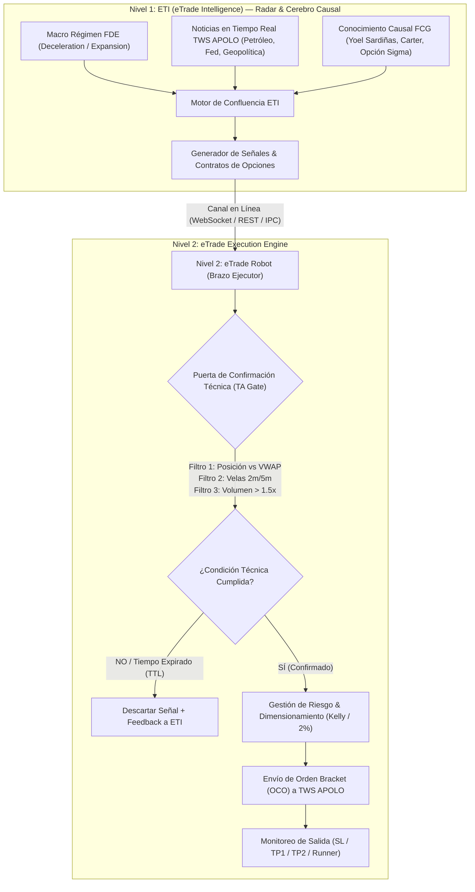
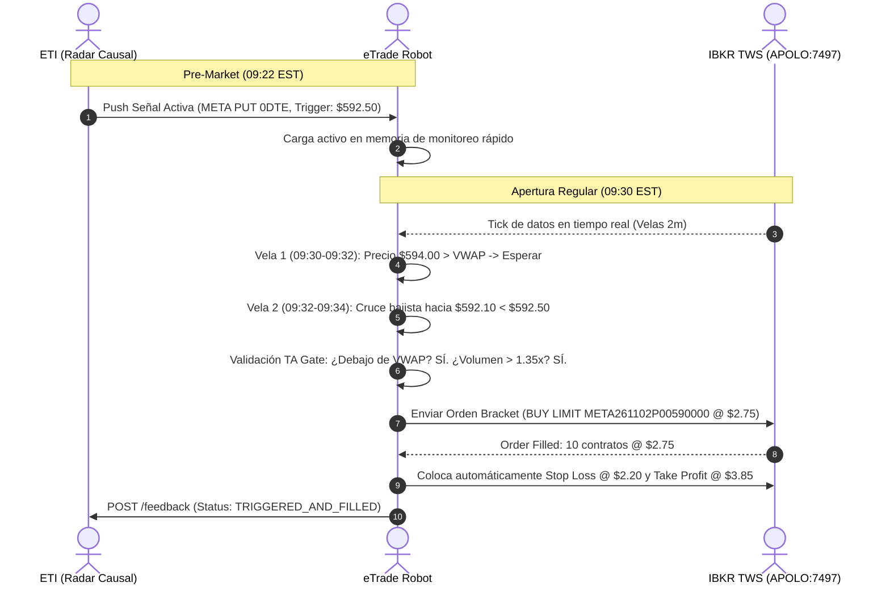

# Especificación de Integración ETI → eTrade Robot
## Protocolos de Comunicación, Estructuras de Datos y Matriz de Señales en Tiempo Real

> **Versión:** 2.3.0  
> **Sistema Emisor:** eTrade Intelligence (ETI) — Motor Causal FDE/FCG & Radar de Mercado  
> **Sistema Receptor:** eTrade Execution Engine — Robot de Microestructura, Análisis Técnico & Broker TWS  
> **Fecha de Emisión:** Noviembre 2026  
> **Estado:** Aprobado para Implementación

---

## 1. Arquitectura de Integración: Modelo de 2 Niveles

El flujo institucional separa las funciones cognitivas y macro de las funciones de microestructura y ejecución de órdenes:



---

## 2. Cadencia Temporal de Publicación

| Ventana Temporal | Frecuencia | Propósito de ETI | Comportamiento Esperado en eTrade |
| :--- | :--- | :--- | :--- |
| **Pre-Market Opening** | 09:15 - 09:29 EST (Snapshot cada 5 min) | Emite la **Matriz de Escenarios del Día** (Top 3-5 activos con sesgo direccional, contratos específicos 0DTE/Semanales y zonas de activación). | Carga activos en memoria de alta velocidad, suscribe datos de nivel 2 (Order Book) en TWS y prepara triggers de ruptura del rango de apertura (ORB). |
| **Apertura Regular** | 09:30 - 10:00 EST (Cada 1 min) | Ajusta probabilidades en base al impacto de volumen de apertura y reacción a noticias de última hora. | Evalúa rechazo o soporte en VWAP en velas de 2m. Si se activa el gatillo, lanza la orden al broker. |
| **Sesión Intradía** | 10:00 - 15:30 EST (Cada 5 o 15 min) | Monitorea la absorción de mercado, giros de tendencia, noticias inesperadas (APOLO) y desbalance de griegas ($\Gamma$ squeeze). | Identifica retrocesos a medias móviles (EMA 9/20) o consolidaciones para entradas de continuación. |
| **Cierre / Power Hour** | 15:30 - 16:00 EST (Cada 5 min) | Cierre de posiciones 0DTE y evaluación de posibles posiciones Swing hacia el día siguiente. | Bloquea nuevas entradas 0DTE por riesgo de decaimiento Theta ($\Theta$) y gestiona cierres automáticos. |

---

## 3. Estructura de Datos Unificada (`ETI_Signal_Payload`)

### 3.1 Definición TypeScript (Código ETI Engine)

```typescript
export type StrategyHorizon = 'SCALPING' | 'INTRADAY' | 'DAY_TRADE' | 'SWING';
export type OrderAction = 'BUY_TO_OPEN' | 'SELL_TO_CLOSE' | 'STOP_LOSS' | 'TAKE_PROFIT';
export type AssetClass = 'OPTION_0DTE' | 'OPTION_WEEKLY' | 'EQUITY' | 'FUTURE';
export type TriggerType = 'VWAP_REJECTION' | 'PRICE_BREAKOUT' | 'ORB_BREAK' | 'EMA_PULLBACK';
export type SignalStatus = 'ACTIVE' | 'TRIGGERED' | 'EXPIRED' | 'CANCELLED';

export interface ETISignalPayload {
  // Identificación y Control
  signal_id: string;              // UUID v4 único de la recomendación
  timestamp: string;              // ISO 8601 de emisión (ej. 2026-11-02T09:20:00.000Z)
  expires_at: string;             // ISO 8601 límite de validez (TTL de la señal)
  cadence: 'PRE_MARKET' | 'INTRADAY_5M' | 'INTRADAY_15M' | 'REALTIME_ALERT';
  status: SignalStatus;

  // Activo y Contrato
  symbol: string;                 // Subyacente (META, SPY, QQQ, NVDA, SPX)
  asset_class: AssetClass;
  action: OrderAction;
  
  // Especificación de Opciones (si aplica)
  options_contract?: {
    contract_symbol: string;      // ej. "META261102P00590000"
    option_type: 'CALL' | 'PUT';
    strike: number;               // ej. 590.0
    expiration_date: string;      // "2026-11-02"
    dte: number;                  // 0 para 0DTE, 4 para semanal
    target_delta: number;         // ej. -0.42 (para PUT) o 0.45 (para CALL)
    max_bid_ask_spread_pct: number; // Tolerancia máxima de spread (ej. 4.0%)
    estimated_contract_price: number; // Precio indicativo de la prima (ej. $2.85)
  };

  // Clasificación Estratégica
  strategy: {
    horizon: StrategyHorizon;     // SCALPING (1-5 min) | INTRADAY (15m - 2h)
    bias: 'BULLISH' | 'BEARISH' | 'NEUTRAL_RANGE';
    playbook_rule: string;        // ej. "META_PUT_VWAP_FAILURE_0DTE"
    expected_duration_minutes: number; // ej. 30
  };

  // Inteligencia Causal ETI
  causal_context: {
    fde_regime: 'DECELERATION' | 'EXPANSION' | 'STAGFLATION' | 'RECOVERY';
    fcg_confidence_pct: number;   // ej. 88.0
    primary_source: string;       // ej. "Yoel Sardiñas - Causal Calibration #14"
    catalyst_summary: string;     // Titular de noticia determinante
    catalyst_impact_score: number;// -1.0 (Muy bajista) a +1.0 (Muy alcista)
    greeks_thesis: string;        // Razón de griegas (Gamma Cascade, High IV Crush)
  };

  // Puerta de Confirmación Técnica (TA Gate) para eTrade
  technical_gate: {
    trigger_type: TriggerType;
    underlying_trigger_price: number; // Precio del subyacente que gatilla la compra
    trigger_operator: 'LESS_THAN_OR_EQUAL' | 'GREATER_THAN_OR_EQUAL' | 'CROSS_BELOW' | 'CROSS_ABOVE';
    indicator_requirements: {
      vwap_condition: 'PRICE_BELOW_VWAP' | 'PRICE_ABOVE_VWAP' | 'ANY';
      ema_fast_vs_slow: 'FAST_BELOW_SLOW' | 'FAST_ABOVE_SLOW' | 'ANY';
      min_relative_volume: number;    // ej. 1.2x del volumen promedio del periodo
      timeframe_confirmation: '1m' | '2m' | '5m';
    };
  };

  // Niveles de Gestión de Riesgo (Bracket Order)
  risk_management: {
    invalidation_underlying: number;  // Nivel de stop en la acción (ej. $596.50)
    stop_loss_contract_pct: number;   // Máxima pérdida tolerada en prima (-18.0%)
    take_profit_1_pct: number;        // Primer objetivo (+35.0% - cierre de 50%)
    take_profit_2_pct: number;        // Segundo objetivo (+75.0% - cierre de 30%)
    runner_trailing_stop_pct: number; // Trailing para el 20% remanente (+15.0%)
    max_account_risk_pct: number;     // Riesgo máximo sobre capital total (ej. 2.0%)
  };

  // Guardrails de Seguridad ETI
  safety_guardrails: {
    execution_allowed: boolean;       // Si false, eTrade SOLO simula / audita
    max_slippage_pct: number;         // Deslizamiento máximo aceptable (ej. 1.5%)
    circuit_breaker_active: boolean;  // Kill-switch del sistema
  };
}
```

---

### 3.2 Definición Python Pydantic (Para el Robot eTrade)

```python
from pydantic import BaseModel, Field
from typing import Optional, List, Literal
from datetime import datetime

class OptionsContractSpec(BaseModel):
    contract_symbol: str
    option_type: Literal["CALL", "PUT"]
    strike: float
    expiration_date: str
    dte: int
    target_delta: float
    max_bid_ask_spread_pct: float = 5.0
    estimated_contract_price: float

class StrategySpec(BaseModel):
    horizon: Literal["SCALPING", "INTRADAY", "DAY_TRADE", "SWING"]
    bias: Literal["BULLISH", "BEARISH", "NEUTRAL_RANGE"]
    playbook_rule: str
    expected_duration_minutes: int

class CausalContext(BaseModel):
    fde_regime: str
    fcg_confidence_pct: float
    primary_source: str
    catalyst_summary: str
    catalyst_impact_score: float
    greeks_thesis: str

class IndicatorRequirements(BaseModel):
    vwap_condition: Literal["PRICE_BELOW_VWAP", "PRICE_ABOVE_VWAP", "ANY"]
    ema_fast_vs_slow: Literal["FAST_BELOW_SLOW", "FAST_ABOVE_SLOW", "ANY"]
    min_relative_volume: float = 1.0
    timeframe_confirmation: Literal["1m", "2m", "5m"]

class TechnicalGate(BaseModel):
    trigger_type: Literal["VWAP_REJECTION", "PRICE_BREAKOUT", "ORB_BREAK", "EMA_PULLBACK"]
    underlying_trigger_price: float
    trigger_operator: Literal["LESS_THAN_OR_EQUAL", "GREATER_THAN_OR_EQUAL", "CROSS_BELOW", "CROSS_ABOVE"]
    indicator_requirements: IndicatorRequirements

class RiskManagement(BaseModel):
    invalidation_underlying: float
    stop_loss_contract_pct: float
    take_profit_1_pct: float
    take_profit_2_pct: float
    runner_trailing_stop_pct: float
    max_account_risk_pct: float = 2.0

class SafetyGuardrails(BaseModel):
    execution_allowed: bool
    max_slippage_pct: float = 1.5
    circuit_breaker_active: bool = False

class ETISignal(BaseModel):
    signal_id: str
    timestamp: datetime
    expires_at: datetime
    cadence: Literal["PRE_MARKET", "INTRADAY_5M", "INTRADAY_15M", "REALTIME_ALERT"]
    status: Literal["ACTIVE", "TRIGGERED", "EXPIRED", "CANCELLED"]
    symbol: str
    asset_class: Literal["OPTION_0DTE", "OPTION_WEEKLY", "EQUITY", "FUTURE"]
    action: Literal["BUY_TO_OPEN", "SELL_TO_CLOSE", "STOP_LOSS", "TAKE_PROFIT"]
    options_contract: Optional[OptionsContractSpec] = None
    strategy: StrategySpec
    causal_context: CausalContext
    technical_gate: TechnicalGate
    risk_management: RiskManagement
    safety_guardrails: SafetyGuardrails
```

---

## 4. Ejemplo Concreto de Payload: META PUT 0DTE (Caso Yoel Sardiñas)

Este payload representa la recomendación que ETI entregaría a eTrade a las **09:22:00 EST** antes de la apertura:

```json
{
  "signal_id": "eti-sig-20261102-meta-put-001",
  "timestamp": "2026-11-02T14:22:00.000Z",
  "expires_at": "2026-11-02T14:45:00.000Z",
  "cadence": "PRE_MARKET",
  "status": "ACTIVE",
  "symbol": "META",
  "asset_class": "OPTION_0DTE",
  "action": "BUY_TO_OPEN",
  "options_contract": {
    "contract_symbol": "META261102P00590000",
    "option_type": "PUT",
    "strike": 590.0,
    "expiration_date": "2026-11-02",
    "dte": 0,
    "target_delta": -0.42,
    "max_bid_ask_spread_pct": 3.5,
    "estimated_contract_price": 2.75
  },
  "strategy": {
    "horizon": "INTRADAY",
    "bias": "BEARISH",
    "playbook_rule": "META_GAMMA_CASCADE_PUT_0DTE",
    "expected_duration_minutes": 45
  },
  "causal_context": {
    "fde_regime": "DECELERATION",
    "fcg_confidence_pct": 91.5,
    "primary_source": "Yoel Sardiñas (FCG Calibración #14 - Short Gamma Cascade)",
    "catalyst_summary": "Subida de rendimientos de bonos a 10 años (4.93%) + Titular APOLO sobre presiones regulatorias antimonopolio.",
    "catalyst_impact_score": -0.78,
    "greeks_thesis": "Gamma extrema en strikes $590-$595. Si el precio pierde $592.50, los market makers deben vender acciones para cubrir delta, acelerando la caída intradía."
  },
  "technical_gate": {
    "trigger_type": "VWAP_REJECTION",
    "underlying_trigger_price": 592.50,
    "trigger_operator": "LESS_THAN_OR_EQUAL",
    "indicator_requirements": {
      "vwap_condition": "PRICE_BELOW_VWAP",
      "ema_fast_vs_slow": "FAST_BELOW_SLOW",
      "min_relative_volume": 1.35,
      "timeframe_confirmation": "2m"
    }
  },
  "risk_management": {
    "invalidation_underlying": 596.20,
    "stop_loss_contract_pct": -20.0,
    "take_profit_1_pct": 40.0,
    "take_profit_2_pct": 90.0,
    "runner_trailing_stop_pct": 20.0,
    "max_account_risk_pct": 2.5
  },
  "safety_guardrails": {
    "execution_allowed": true,
    "max_slippage_pct": 1.5,
    "circuit_breaker_active": false
  }
}
```

---

## 5. Canales de Entrega en Línea (Streaming, REST & Archivo Compartido)

Para garantizar **0% de pérdida de señal** y resiliencia ante cortes, se implementan tres canales sincronizados:

### Canal 1: WebSocket de Baja Latencia (Streaming en Tiempo Real)
* **URL:** `ws://localhost:3001/ws/etrade-signals`
* **Protocolo:** JSON over WebSocket con latencia típica $< 8\text{ ms}$.
* **Eventos Emitidos por ETI:**
  * `SIGNAL_PUBLISHED`: Nueva recomendación generada.
  * `SIGNAL_MODIFIED`: Actualización de niveles (ej. ajuste de Stop o Target).
  * `SIGNAL_CANCELLED`: Invalidación temprana por catalizador adverso repentino.
  * `MARKET_HEARTBEAT`: Pulso cada 15 segundos para verificar sincronización.

### Canal 2: API REST Polling (Pull a Demanda cada 5 o 15 minutos)
* **Endpoint de Lectura:** `GET http://localhost:3001/api/eti/v1/etrade/signals/active`
  * Query parameters: `cadence=PRE_MARKET|INTRADAY_5M|INTRADAY_15M`, `symbol=META`, `horizon=INTRADAY`.
* **Endpoint de Confirmación (Feedback del Robot):** `POST http://localhost:3001/api/eti/v1/etrade/signals/feedback`
  * eTrade informa a ETI si ejecutó la orden, si la descartó por fallo del filtro técnico (TA Gate) o si fue llenada en TWS con su precio real de ejecución.

### Canal 3: Archivo Local de Memoria Compartida / IPC (Zero-Network Fallback)
* **Ruta en Disco:** `backend/engine/src/data/etrade_signals_live.json`
* **Mecanismo:** ETI escribe en este archivo de forma atómica cada vez que calcula una proyección. Si la conexión de red local llegara a tener micro-cortes, el proceso de eTrade puede leer directamente el archivo en disco con latencia de sub-milisegundo.

---

## 6. Lógica de Decisión del Robot eTrade (Algoritmo de Ejecución)



---

## 7. Dictamen y Recomendaciones Estratégicas

1. **Gobernanza del "TA Gate"**:
   * ETI provee la **probabilidad y la asimetría macro**; eTrade provee el **timing quirúrgico de entrada**. Esta división previene compras impulsivas en momentos de spread excesivo.
2. **Control de Deslizamiento (Slippage)**:
   * En opciones 0DTE durante los primeros 10 minutos de mercado, los spreads pueden inflarse a más del 10%. eTrade debe rechazar contratos con spread superior al `max_bid_ask_spread_pct` definido en el contrato.
3. **Persistencia y Auditoría**:
   * Cada señal emitida por ETI y su resultado de ejecución en eTrade deben quedar grabados en la tabla `eti_etrade_execution_ledger` para alimentar la calibración causal continua del sistema.
