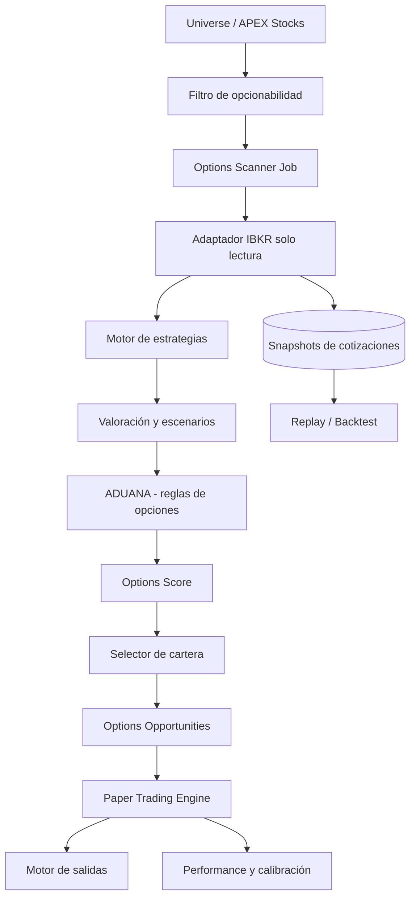

# eTrader APEX Options
## Arquitectura y plan de implementación para Antigravity

**Versión:** 1.2 (revisión de la v1.0; incluye pestaña "Opciones" en Settings)
**Fecha:** 17 de octubre de 2026
**Estado:** Especificación lista para construcción por fases, con puertas de decisión (gates)
**Modo:** Simulación / Paper Trading únicamente
**Horizonte operativo inicial:** Intradiario
**Universo:** hasta 20 subyacentes de Universe / APEX Stocks que superen el filtro de "opcionabilidad"
**Selección diaria:** 0 a 3 operaciones (nunca forzadas)
**Riesgo máximo por operación:** USD 50 (techo duro)

---

## 0. Cómo leer este documento

Etiquetas usadas en todo el texto:

- **[FIJO]**: decisión de producto. No se cambia sin aprobación explícita.
- **[POR DEFECTO]**: parámetro inicial, configurable y sujeto a calibración. No es una ley de mercado.
- **[VERIFICAR]**: depende de lo que Antigravity encuentre en el repositorio, en IBKR o en la cuenta. Se resuelve en los Sprints 0 y 0.5 y se documenta.

**Orden obligatorio de trabajo:** Sprint 0 (auditoría) → Sprint 0.5 (factibilidad de datos, Gate G1) → resto. **No se construyen estrategias ni scoring antes de superar G1.**

---

## 1. Resumen ejecutivo

Construir **eTrader APEX Options** dentro de eTrade v5.0. El módulo toma acciones ya seleccionadas por Universe / APEX Stocks, comprueba que tengan opciones realmente operables, genera estrategias de riesgo definido, simula su resultado neto de costes, las puntúa y presenta hasta tres oportunidades diarias para Paper Trading.

El módulo **reutiliza** Universe, señales APEX, autenticación, layout, Settings, ADUANA y el patrón de worker local de Stocks. Tiene **propios**: adaptador de opciones (solo lectura), motor de estrategias, valoración, riesgo, scoring, selector, posiciones simuladas y métricas.

### Principio rector [FIJO]

> No elegir la acción que más subió ni la opción con el mayor beneficio teórico. Elegir operaciones con expectativa neta positiva **bajo supuestos explícitos**, riesgo definido, cotizaciones negociables y límites de cartera cumplidos. Si nada cumple, no se opera.

Las probabilidades y expectativas del modelo son estimaciones, no garantías.

---

## 2. Qué cambió respecto a la v1.0

| # | Tema | v1.0 | v1.1 | Razón |
|---|---|---|---|---|
| 1 | Factibilidad | Se asumía que el universo APEX tiene opciones líquidas | Nuevo **filtro de opcionabilidad** y **Sprint 0.5 con Gate G1 (go/no-go)** | Los candidatos típicos del scanner son acciones de USD 10–25 con catalizadores; muchas tienen cadenas ilíquidas o inexistentes |
| 2 | Expectativa | "P&L esperado neto" sin definir distribución | Modelo explícito de dos distribuciones (neutral y con sesgo APEX) | Con probabilidades neutrales al riesgo, la expectativa es ≈ −costes para toda operación. Sin sesgo explícito el score es ruido |
| 3 | Despliegue | "Backend Python" genérico | **Options Worker local** junto al Stocks Worker, cola de trabajos vía Supabase | IB TWS corre local; el droplet no puede alcanzarlo |
| 4 | Gatekeeper | Controles de riesgo propios del módulo | **Toda orden simulada pasa por ADUANA** (extensión aditiva con reglas de opciones) | Coherencia con el resto de la plataforma |
| 5 | Límites | Variables de entorno | **Pestaña "Opciones" en Settings** (valores por defecto y editables, §17) + techos duros en entorno | Parámetros ajustables sin redeploy; el frontend nunca supera los techos |
| 6 | Límites inconsistentes | 3 ops/día, USD 50 c/u, riesgo abierto USD 100, pérdida diaria USD 50 | Reglas de dimensionamiento y de presupuesto de riesgo restante definidas con precisión (§12) | v1.0 permitía solo ~1 operación efectiva al día |
| 7 | Salidas | Pendientes | Plan de salida por defecto (TP, stop, tiempo, invalidación) | Sin salida definida no hay simulación válida |
| 8 | Backtesting | Sprint 7, con datos "disponibles" | **Grabador de snapshots desde el Sprint 2** y validación principal en forward paper | IBKR no ofrece histórico barato de bid/ask de opciones |
| 9 | Adaptador IBKR | Endpoints sin órdenes reales | Adaptador **sin métodos de órdenes** + prueba automática | Bloqueo por construcción, no por bandera |
| 10 | Riesgo de eventos | Parcial | Filtro de earnings/catalizadores binarios, IV vs HV, horario de entrada | Las señales APEX incluyen FDA/earnings: IV extrema y riesgo de IV crush |
| 11 | Alcance UI | 8 pantallas | **5 pantallas en V1**; Strategy Lab y Backtesting pasan a V1.1 | Reducir superficie antes de validar datos |
| 12 | Tablas | Schema `options` | Prefijo `opt_` en `public` por defecto **[VERIFICAR]** | Evita exponer un schema adicional en la API de Supabase |
| 13 | Covered Call / Cash-Secured Put | No mencionadas | Fase 2 explícita (dependen de posiciones de Stocks) | La UI actual ya las anuncia; evita ambigüedad |

---

## 3. Objetivos y alcance

### 3.1 Objetivos

1. Reutilizar Universe y las señales APEX Stocks sin duplicar cálculos ni tablas maestras.
2. Obtener cadenas, cotizaciones y griegas de IBKR con trazabilidad del tipo de dato.
3. Descartar subyacentes sin opciones operables antes de gastar líneas de datos.
4. Generar estrategias de riesgo definido compatibles con la señal y el presupuesto.
5. Simular P&L neto por precio, tiempo e IV con ejecución conservadora (bid/ask + slippage).
6. Puntuar, ordenar y seleccionar hasta tres operaciones con control de concentración.
7. Validar toda orden simulada en ADUANA.
8. Registrar candidatas aceptadas y rechazadas con motivo, cotizaciones usadas y versión del modelo.
9. Medir resultados en forward paper (principal) y replay de snapshots (secundario).
10. Mantener el envío de órdenes reales **inexistente** en esta fase.

### 3.2 Fuera de alcance de V1

- Órdenes reales (el adaptador no tendrá métodos de órdenes).
- Venta de opciones desnudas o cualquier estrategia con pérdida no acotada.
- Opciones sobre Crypto o Forex.
- Covered Call y Cash-Secured Put (Fase 2, §19).
- 0DTE como estrategia predeterminada.
- Modelos propios de predicción de precio: Options **consume** señales de APEX/TimesFM, no las recalcula.
- Presentar probabilidades como certezas o cotizaciones retrasadas como tiempo real.
- Reemplazar o modificar Universe Builder o el scanner de Stocks.

---

## 4. Principios de arquitectura

1. **Universe compartido; lógica de opciones independiente.**
2. **Paper por construcción:** el módulo no contiene código de envío de órdenes (§14.2).
3. **Datos trazables:** cada precio lleva timestamp, fuente y `market_data_type`.
4. **Sin ceros falsos:** dato ausente = `NULL` y se bloquea el cálculo dependiente.
5. **Ejecución conservadora:** compras al ask, ventas al bid, más slippage; nunca asumir fill al último precio ni al mid.
6. **Riesgo definido:** solo estrategias con pérdida máxima calculable.
7. **Sin look-ahead bias** en replay y en cálculo de señales.
8. **Versionado:** `model_version`, parámetros y snapshot usados quedan registrados en cada candidata.
9. **Tolerancia a fallos:** reconexión, pacing, contratos inválidos, datos incompletos, TWS caído.
10. **Sin operaciones forzadas:** 0, 1, 2 o 3 son resultados válidos.
11. **Seguridad:** credenciales IBKR y `service_role` solo en backend; RLS según convención del proyecto.
12. **Cambios aditivos y reversibles** sobre el código existente, con pruebas de regresión.

---

## 5. Arquitectura

### 5.1 Flujo funcional



### 5.2 Despliegue **[VERIFICAR contra el patrón actual del Stocks Worker]**

| Componente | Dónde corre | Nota |
|---|---|---|
| Frontend Next.js | Vercel | Páginas de Opciones tras feature flag |
| FastAPI (endpoints de lectura, creación de jobs) | Droplet DigitalOcean | No habla con IBKR |
| **Options Worker** | **Local, junto al Stocks Worker** | Único proceso con acceso a IB TWS; usa su propio `clientId` |
| Supabase | Cloud | Tablas `opt_*`, jobs, snapshots, resultados |

Flujo de jobs: la API inserta una fila en `opt_jobs`; el Options Worker la toma (polling o realtime), ejecuta y escribe resultados. **Ningún endpoint del droplet abre conexión a TWS.**

### 5.3 Convivencia con Stocks en IBKR

- `clientId` distinto al del Stocks Worker; preferir reutilizar la conexión solo si el patrón actual lo permite de forma segura **[VERIFICAR]**.
- Las líneas de datos de mercado son limitadas y se comparten con Stocks. Parámetro `max_concurrent_quotes` (por defecto 50) y reserva para Stocks **[VERIFICAR el límite real de la cuenta]**.
- Una sesión de datos en vivo por usuario: abrir TWS/otra sesión puede interrumpir los datos. El adaptador debe detectarlo y marcar `STALE`/`ERROR`.

---

## 6. Integración con la plataforma existente

### 6.1 Reutilizar

- Universe Builder, APEX Stocks (score, ADX, RVOL, dirección, catalizadores) y datos fundamentales.
- Autenticación, layout, componentes UI, tema oscuro y convenciones actuales.
- Settings (almacenamiento de parámetros) y System Logs.
- Entorno PAPER ya existente en la plataforma; infraestructura de órdenes/posiciones simuladas si es extensible sin romper Stocks **[VERIFICAR]**. Si no lo es, tablas propias `opt_*` (decisión documentada en Sprint 0).
- ADUANA como validador de órdenes.

### 6.2 No duplicar

- Tabla maestra de acciones, fundamentales, indicadores ya calculados por Stocks, gestión de usuarios.

### 6.3 Independiente en Options

- Cadenas, contratos, cotizaciones, griegas, estrategias, valoración, Options Score, selector, posiciones simuladas, performance y reglas de riesgo de opciones.

### 6.4 ADUANA para opciones **[VERIFICAR la interfaz real]**

ADUANA se extiende de forma **aditiva** con `market_type = OPTIONS`. Toda entrada simulada y toda salida pasan por ADUANA. Regresión obligatoria sobre Crypto, Forex y Stocks.

Clasificación propuesta de salidas (alineada con PASIVA/ACTIVA ya usada en la plataforma):

- **PASIVA:** stop simulado, cierre forzado por horario, cierre por datos inválidos.
- **ACTIVA:** take profit, invalidación de señal.

Reglas de validación de opciones:

| Regla | Condición para aprobar |
|---|---|
| O-1 | `execution_mode = paper` |
| O-2 | Riesgo definido: toda pierna vendida está cubierta; `max_loss` calculable |
| O-3 | `max_loss` (con costes) ≤ riesgo máximo por operación |
| O-4 | Σ `max_loss` de posiciones abiertas + la nueva ≤ riesgo abierto máximo |
| O-5 | No se ha activado el stop diario |
| O-6 | Spread relativo por pierna ≤ umbral y sobrecoste de ejecución neto ≤ umbral |
| O-7 | Datos `LIVE` y antigüedad de cotización ≤ `max_quote_age_sec` |
| O-8 | Dentro de la ventana de entrada (§8) |
| O-9 | Sin earnings/evento binario dentro de la vida del contrato (o bandera aceptada en Settings) |
| O-10 | Idempotencia: la misma candidata no se abre dos veces |
| O-11 | Una posición abierta por subyacente |

### 6.5 Contrato interno del universo (Python / Pydantic)

El backend es Python/FastAPI; usar modelos Pydantic. Ajustar nombres al esquema real tras la auditoría.

```python
class ApexUnderlyingCandidate(BaseModel):
    symbol: str
    underlying_conid: int | None = None
    apex_score: float | None = None
    fundamental_score: float | None = None
    momentum_score: float | None = None
    direction: Literal["bullish", "bearish", "neutral"] | None = None
    adx: float | None = None
    relative_volume: float | None = None
    price: float | None = None
    price_change_pct: float | None = None
    catalyst_flags: list[str] = []
    source_timestamp: datetime  # siempre UTC
```

---

## 7. Filtro de opcionabilidad y universo de opciones

Antes de pedir cotizaciones, cada subyacente del universo APEX debe superar:

| Criterio | Valor **[POR DEFECTO]** |
|---|---|
| Tiene opciones listadas y expiraciones dentro de la ventana DTE | Obligatorio |
| Precio del subyacente | ≥ USD 5 |
| Separación entre strikes relativa al precio | ≤ 5% |
| Open interest de las opciones ATM (±2 strikes) | ≥ 300 |
| Volumen de las opciones ATM | Preferir ≥ 100 |
| Spread relativo ATM | ≤ 10% |
| Earnings o catalizador binario conocido dentro del DTE | Bloquea (salvo bandera aceptada) |
| Subyacente sin halt ni condición especial | Obligatorio |
| Relación IV/HV20 | Registrar; marcar "prima cara" si > umbral configurable |

Resultado: lista `opt_underlyings` con `optionable = true/false` y motivo. **Si el filtro deja menos de 5 subyacentes de forma sistemática**, aplica la decisión D-1 (§21): lista complementaria de subyacentes líquidos, desactivada por defecto, que solo se habilita con aprobación.

Los candidatos "Top 3 Foco de Compra" de Stocks no tienen por qué ser los mejores para opciones. Options no depende de ese ranking; usa el universo APEX y su propio filtro.

---

## 8. Horizonte, vencimientos y ventanas horarias

El horizonte de salida es intradiario. El vencimiento del contrato es independiente.

- **DTE a comparar [POR DEFECTO]:** 7–30 días. Hipótesis a validar en shadow.
- **Zona horaria:** mercado en America/New_York; almacenar en UTC; mostrar ET y hora local del usuario.
- **Calendario:** festivos y cierres tempranos (por ejemplo, 13:00 ET) obligatorios.
- **Ventana de entrada [POR DEFECTO]:** desde 15 minutos después de la apertura hasta 30 minutos antes del cierre.
- **Cierre forzado [POR DEFECTO]:** 15 minutos antes del cierre regular.
- Datos retrasados, obsoletos o TWS desconectado: bloquear nuevas entradas y alertar; para posiciones abiertas, generar evento `close_blocked_data` y cerrar al precio conservador cuando se recupere el dato o al forzado horario.
- Registrar timestamps de señal, cotización, entrada y salida simuladas.

---

## 9. Estrategias

### 9.1 V1 (Sprints 3–7)

| Estrategia | Escenario | Pérdida máx. por contrato | Equilibrio |
|---|---|---|---|
| Long Call | Alcista | (débito + costes) × 100 | K + débito |
| Long Put | Bajista | (débito + costes) × 100 | K − débito |
| Bull Call Spread | Alcista moderado | (débito + costes) × 100 | K_bajo + débito |
| Bear Put Spread | Bajista moderado | (débito + costes) × 100 | K_alto − débito |

Beneficio máximo de spreads: `(ancho − débito) × 100 − costes`.

**Nota de factibilidad [FIJO como advertencia]:** con USD 50 de riesgo, una opción larga cuesta como máximo USD 0,50 por contrato (prima). Eso empuja hacia opciones OTM baratas, que suelen tener peor spread y menor probabilidad. Los spreads de débito suelen ser la vía más realista, a costa de doble spread de ejecución. El Sprint 0.5 mide si existen candidatas viables.

### 9.2 V1.1 (Sprint 8)

- **Iron Condor** con alas protectoras; riesgo = ancho de ala − crédito + costes. No se recomienda en tendencia direccional fuerte.
- **Long Straddle / Strangle** cuando se espera movimiento grande sin dirección; evaluar coste frente al movimiento esperado.

### 9.3 Fase 2 (fuera de V1)

- **Covered Call** y **Cash-Secured Put**: requieren integrar posiciones y capital de Stocks. Se especifican en un documento aparte tras validar V1.

### 9.4 Exclusiones

- Opciones vendidas sin cobertura; riesgo no calculable; contratos sin cotización válida; coste por encima del presupuesto; datos retrasados en señal en tiempo real; 0DTE.

---

## 10. Valoración y simulación

### 10.1 Precios de ejecución

- Compra: ask; venta: bid; multi-leg: valorar cada pierna y el neto ejecutable (no mid).
- Costes: comisión por contrato `[POR DEFECTO] 0,65 USD` **[VERIFICAR con la tarifa de la cuenta]**, más fees regulatorios y slippage configurable (normal y adverso).
- Guardar: precio teórico, referencia, ejecución simulada y método.

### 10.2 Movimiento esperado y distribución del subyacente

Movimiento esperado en el horizonte de `h` horas de mercado:

```
sigma_h = IV_atm * sqrt(h / (252 * 6.5))
move_expected = precio * sigma_h
```

Se usan **dos distribuciones** lognormales del precio de salida:

- **A. Neutral:** deriva 0. Sirve como línea base. Su expectativa es ≈ −costes para cualquier operación; se muestra como "coste puro de entrada".
- **B. Con sesgo APEX:** deriva `mu = dirección × alpha × sigma_h`, donde `alpha` es el parámetro de fuerza del sesgo.
  - `alpha` **[POR DEFECTO] = 0,25**, hipótesis conservadora, **no un hecho**.
  - Se calibra con resultados de paper: si `alpha` calibrado ≤ 0, el sistema no tiene ventaja y debe seleccionar pocas o ninguna operación.

### 10.3 Repricing al momento de salida

- Black-Scholes con IV por pierna y tiempo restante en el momento de salida simulado.
- Escenarios de IV: −20%, −10%, 0, +10%, +20% relativos.
- Precio de salida al lado bid (o ask si se compra para cerrar) con spread de salida igual al de entrada ×1 (normal) y ×1,5 (adverso).
- Griegas del broker cuando existan y sean válidas; cálculo propio solo como verificación cruzada.
- Opciones americanas: ignorar ejercicio anticipado en V1 (horizonte intradiario); documentarlo como limitación.

### 10.4 Métricas por candidata

- Débito/crédito neto, pérdida máxima, beneficio máximo, equilibrios.
- `ev_neutral_net` y `ev_view_net` (esperanza neta bajo A y B).
- `pop_neutral` y `pop_view`: probabilidad de P&L neto > 0 al salir. **Etiqueta en UI: "teórica".**
- Retorno sobre riesgo, sensibilidad a IV y tiempo, spread/costes, calidad de datos, motivos de aprobación o descarte.

### 10.5 Elegibilidad por expectativa

Una candidata es elegible solo si `ev_view_net > 0` y `ev_view_net / max_loss ≥ min_ev_ratio` (**[POR DEFECTO] 0,05**) además de los filtros obligatorios.

---

## 11. Options Score

Escala 0–100. No es una probabilidad. Los filtros obligatorios se aplican **antes** de puntuar.

| Componente | Peso **[POR DEFECTO]** | Normalización inicial (lineal por tramos) |
|---|---:|---|
| Expectativa neta (`ev_view_net / max_loss`) | 30% | 0 si ≤ 0; 100 si ≥ 0,30 |
| Calidad de señal APEX del subyacente | 20% | APEX score ya en escala 0–100; penalizar dirección incoherente con la estrategia |
| Liquidez y calidad de cotización | 20% | Spread relativo 0% → 100, 10% → 0; ajuste por volumen/OI; 0 si el dato no es `LIVE` |
| Riesgo y escenarios adversos | 15% | Resultado en slippage adverso e IV −20% frente a `max_loss` |
| IV y griegas | 10% | Penalizar IV/HV alto en estrategias de débito; premiar theta/gamma coherentes con el horizonte |
| Catalizadores y contexto | 5% | Contexto favorable sin evento binario dentro del DTE |

Reglas:

- Pesos y anclas configurables sin editar código.
- Registrar `model_version`, parámetros, timestamps y fuente de datos.
- Un score alto nunca vuelve elegible una operación inválida.
- Evitar sobreajuste a pocos días o acciones; cualquier cambio de pesos requiere nueva `model_version`.

### 11.1 Selector de cartera

Rankings por estrategia y ranking global de elegibles. Selección greedy por score con restricciones:

1. Máximo 1 posición por subyacente.
2. Máximo 2 posiciones en la misma dirección.
3. Suma de `max_loss` ≤ riesgo abierto restante (§12).
4. Si una candidata no cabe en el riesgo restante, el selector puede proponer la misma estrategia con menos riesgo (por ejemplo, spread más estrecho) solo si sigue siendo elegible.

---

## 12. Riesgo y presupuesto

### 12.1 Parámetros iniciales

| Parámetro | Valor | Tipo |
|---|---:|---|
| Riesgo máximo por operación | USD 50 | Techo duro (entorno) |
| Riesgo abierto agregado máximo | USD 100 | Settings, con techo en entorno |
| Stop diario de nuevas entradas | USD 50 | Settings |
| Operaciones seleccionadas por día | hasta 3 | Settings |
| Modo | Paper | Fijo |

### 12.2 Reglas precisas (resuelven la inconsistencia de v1.0)

- **Contratos:** `qty = floor(50 / max_loss_por_contrato)`; si es 0, la candidata se rechaza.
- **Riesgo abierto** = Σ `max_loss` de posiciones abiertas. La nueva operación debe caber en `abierto_max − riesgo_abierto`. Por tanto, con 3 operaciones el selector reparte presupuesto (por ejemplo, 50 + 25 + 25), no asume 50 cada una.
- **Stop diario** se activa cuando `pnl_realizado_hoy + pnl_no_realizado_a_liquidación ≤ −50`. Una posición abierta **no** consume el stop diario por su riesgo teórico; solo por su pérdida marcada.
- Un stop diario activado bloquea nuevas entradas hasta la siguiente sesión.
- Riesgo desconocido o dato inválido = rechazo.

### 12.3 Plan de salida **[POR DEFECTO, a calibrar en shadow]**

| Elemento | Opción larga | Spread |
|---|---|---|
| Take profit | +75% de la prima | 60% del beneficio máximo |
| Stop simulado | −50% de la prima | −50% del débito |
| Salida por tiempo | Cierre forzado antes del cierre regular | Igual |
| Invalidación | Dirección APEX se invierte, o dato `STALE`/`ERROR` | Igual |

Los stops no garantizan la pérdida exacta; el riesgo máximo teórico es distinto del riesgo de ejecución.

---

## 13. Diseño de UI

Integrar en la sección "OPCIONES" del menú actual. La página de "Coming Soon" se reemplaza tras feature flag; si el flag está apagado se conserva.

### 13.1 Pantallas de V1

1. **Options Dashboard**
   - Insignia **PAPER** siempre visible; estado IBKR y tipo de dato (`LIVE/DELAYED/FROZEN/STALE/ERROR`).
   - Riesgo abierto, stop diario, subyacentes optionables vs descartados, candidatas aceptadas/descartadas, top 3, P&L simulado diario y acumulado, alertas.
2. **Options Opportunities**
   - Filtros del scanner integrados (estrategia, dirección, DTE, spread máximo, riesgo máximo, estado de datos).
   - Tabla: rank, ticker, APEX score, estrategia, strikes y vencimiento, débito, EV neto (con sesgo), pérdida y beneficio máximos, probabilidad teórica, spread, hora de entrada/salida previstas, Options Score, estado y motivo.
   - Detalle por fila: piernas, cadena y cotizaciones, griegas, gráfico P&L por precio, escenarios de tiempo e IV, supuestos de ejecución, razones de aprobación/descarte, acción **"Simular entrada"** (nunca "Comprar").
   - Vista de cadena de opciones de solo lectura (cubre la tarjeta "Options Chain" actual) y griegas dentro del detalle (cubre "Greeks Calculator"; no hay calculadora independiente en V1).
3. **Options Positions**
   - Paper abiertas y cerradas, fills por pierna, P&L realizado/no realizado, comisiones, slippage, motivo de salida, eventos, comparación teórico vs ejecutable.
4. **Options Performance**
   - P&L neto, expectancy, win rate, ganancia/pérdida media, profit factor, drawdown, por estrategia/ticker/hora, sensibilidad a slippage, **calibración de probabilidad teórica vs frecuencia observada** y estimación de `alpha`.
5. **Options Data & Status**
   - Estado de datos y permisos, `model_version` y `settings_version` vigentes, avance hacia los gates G1 y G3. Los parámetros se editan en la pestaña **Opciones** de Settings (§17).

### 13.2 V1.1

- **Strategy Lab** (cálculo siempre en backend; sin lógica financiera en el navegador) y **Options Backtesting**.

---

## 14. Adaptador IBKR y estados de datos

### 14.1 Responsabilidades

Resolver subyacente y `conId`, descubrir cadenas, obtener contract details, solicitar y cancelar cotizaciones, leer bid/ask/last/griegas/IV, identificar el tipo de dato, gestionar pacing/reconexión/errores y guardar snapshots. Pedir detalle solo de candidatos relevantes.

### 14.2 Adaptador de solo lectura [FIJO]

- La clase del adaptador **no expone ni importa** métodos de envío o cancelación de órdenes.
- Prueba automática en CI: falla si el código del módulo referencia funciones de órdenes del broker.
- `OPTIONS_EXECUTION_MODE` solo admite `paper`; cualquier otro valor impide el arranque del módulo.
- El Paper Trading Engine no depende del adaptador para ejecutar: simula fills sobre cotizaciones persistidas.

### 14.3 Estados de datos

`LIVE`, `DELAYED`, `FROZEN`, `UNKNOWN`, `STALE`, `ERROR`. Una conexión activa no implica permisos de tiempo real para opciones **[VERIFICAR suscripción de datos de opciones de EE. UU.]**. El open interest no es un dato intradiario en tiempo real.

### 14.4 Grabador de snapshots

Desde el Sprint 2, guardar snapshots de **los contratos candidatos** (no de toda la cadena) en intervalos configurables dentro del horario de mercado. Retención por defecto 90 días, luego agregación. Es la base del replay y de la calibración.

---

## 15. Endpoints

Ajustar prefijos a las convenciones de FastAPI existentes. Los endpoints **no** hablan con IBKR: crean jobs que ejecuta el Options Worker.

| Método | Endpoint | Propósito |
|---|---|---|
| GET | `/api/options/v1/status` | Salud del módulo, worker y estado de datos |
| GET | `/api/options/v1/universe` | Subyacentes APEX con `optionable` y motivo |
| POST | `/api/options/v1/jobs/scan` | Crear job de scanner |
| GET | `/api/options/v1/jobs/{jobId}` | Estado y resultado |
| GET | `/api/options/v1/chains/{symbol}` | Cadena almacenada |
| GET | `/api/options/v1/candidates` | Candidatas con filtros |
| GET | `/api/options/v1/candidates/{id}` | Detalle, escenarios y razones |
| POST | `/api/options/v1/paper-trades/open` | Abrir posición simulada (vía ADUANA) |
| POST | `/api/options/v1/paper-trades/{id}/close` | Cerrar posición simulada (vía ADUANA) |
| GET | `/api/options/v1/positions` | Posiciones simuladas |
| GET | `/api/options/v1/performance/daily` | Resultados del día |
| GET | `/api/options/v1/performance/calibration` | Calibración de probabilidad y `alpha` |
| GET/PUT | `/api/options/v1/settings` | Límites y pesos (PUT restringido por rol y techos) |
| POST | `/api/options/v1/backtests/run` | V1.1: replay de snapshots |

Toda mutación valida autenticación, autorización, estado del mercado, versión del modelo, calidad de datos y ADUANA. Operaciones de apertura idempotentes.

---

## 16. Datos (Supabase)

Prefijo `opt_` en `public` por defecto; usar schema propio solo si la convención del proyecto lo exige y está expuesto en la API **[VERIFICAR en Sprint 0]**. Migraciones aditivas y reversibles; RLS según el patrón actual.

| Tabla | Campos clave |
|---|---|
| `opt_underlyings` | id, symbol, underlying_conid, universe_ref, apex_score, direction, optionable, optionable_reason, iv_hv_ratio, event_flags, last_chain_sync_at |
| `opt_contracts` | id, conid (único), underlying_id, right (C/P), strike, expiry, multiplier, trading_class, exchange, currency, active |
| `opt_quotes_latest` | contract_id, bid, ask, last, volume, open_interest, iv, delta, gamma, theta, vega, underlying_price, market_data_type, quote_time, received_at |
| `opt_snapshots` | id, contract_id, captured_at, bid, ask, last, volume, iv, delta, gamma, theta, vega, underlying_price, market_data_type, data_source |
| `opt_candidates` | id, underlying_id, strategy_type, direction, expiry, legs (JSONB), qty, entry_debit_credit, max_profit, max_loss, breakevens, expected_move, ev_neutral_net, ev_view_net, pop_neutral, pop_view, alpha_used, score, score_breakdown (JSONB), model_version, eligibility_status, rejection_reasons, event_flags, data_quality, exit_plan (JSONB), snapshot_at, created_at |
| `opt_simulations` | id, candidate_id, scenario_config, scenario_results, cost_assumptions, pricing_model_version, created_at |
| `opt_paper_trades` | id, candidate_id, status, qty, entry_time, entry_fills (JSONB por pierna), exit_time, exit_fills, fees, slippage, realized_pnl, unrealized_pnl, exit_reason, aduana_decision_id, created_by, timestamps |
| `opt_risk_events` | id, paper_trade_id, event_type, details, created_at |
| `opt_jobs` | id, type, params, status, result_ref, error, created_by, timestamps |
| `opt_settings` / entradas en Settings | Límites, pesos, umbrales, `alpha`, versión y auditoría de cambios |
| `opt_model_versions` | id, weights, params, created_at, notes |
| `opt_backtest_runs` | id, parameters, model_version, period_start, period_end, status, metrics, created_at, completed_at |

Restricciones: `conid` único; índice en `(underlying_id, expiry, right, strike)`; índice en `(created_at, score DESC)`; estados conocidos con `CHECK`; strikes y cantidades positivos; nunca `NULL` convertido en cero.

---

## 17. Configuración y pestaña "Opciones" en Settings

### 17.1 Pestaña nueva en Settings [FIJO]

Añadir una pestaña **"Opciones"** (subtítulo "Derivados · IBKR") en la página `/settings`, junto a Crypto, Forex, Stocks y Sistema, con el mismo estilo visual y los mismos patrones de campo que la pestaña Stocks (etiqueta, input, unidad y subtexto con el valor efectivo).

Estructura de la pestaña:

1. **Tarjeta de estado** "Options APEX · Paper Trading": indicador de estado, insignia **PAPER** (no editable) e interruptor de activación del módulo (feature flag).
2. **Sección "Configuración de cuenta y riesgo"** (abierta por defecto).
3. **Secciones plegables** B a H (universo, contratos, horario, valoración, score, salidas, gates), cada una con su botón "Restaurar valores por defecto".
4. Pie con `settings_version`, fecha y usuario del último cambio, y enlace a la auditoría.

Reglas de comportamiento:

- **Todos los valores son editables** salvo los marcados como "Bloqueado".
- **Valor efectivo = mínimo entre el valor de Settings y el techo duro del entorno** (§17.3). Los campos en % muestran su equivalente en USD y, si el techo recorta el valor, el subtexto lo indica (por ejemplo: "Efectivo: $50, techo $50").
- Los cambios aplican a **nuevas candidatas y nuevas entradas**; no cierran ni modifican posiciones abiertas, que conservan el plan de salida con el que se abrieron.
- Cada candidata y cada operación guarda el `settings_version` vigente.
- Validaciones: sin negativos; DTE mínimo < máximo; pesos del score suman 100; rangos por campo; confirmación modal al cambiar cualquier valor del grupo A; edición restringida por rol; todo cambio se audita (quién, cuándo, valor anterior y nuevo) y se refleja en System Logs.
- Persistencia en la tabla de Settings existente o en `opt_settings`, según la auditoría del Sprint 0; el frontend nunca escribe directamente en tablas de riesgo sin pasar por la API que valida techos.

### 17.2 Parámetros y valores por defecto

Todos los valores son **[POR DEFECTO]**: recomendaciones iniciales para validar, no leyes de mercado.

#### A. Cuenta y riesgo

| Parámetro | Valor por defecto | Rango | Notas |
|---|---:|---|---|
| Modo de ejecución | PAPER | Bloqueado | No existe otro modo en V1 |
| Módulo activo | Desactivado | Sí/No | Se activa al desplegar el Sprint 1 |
| Capital asignado (base) | USD 1.000 | 100–50.000 | Independiente del capital de Stocks |
| % riesgo máximo por operación | 5% (= USD 50) | 0,5–5% | Recortado por el techo duro |
| % riesgo abierto máximo | 10% (= USD 100) | 1–10% | Suma de `max_loss` de posiciones abiertas |
| % stop diario de nuevas entradas | 5% (= USD 50) | 1–10% | Pérdida realizada + marcada a liquidación |
| Máx. operaciones seleccionadas por día | 3 | 0–3 | Techo en entorno; subirlo exige cambiar el techo |
| Máx. posiciones abiertas simultáneas | 3 | 1–3 | |
| Máx. posiciones en la misma dirección | 2 | 1–3 | |
| Máx. posiciones por subyacente | 1 | Bloqueado | Regla O-11 de ADUANA |
| Comisión por contrato | USD 0,65 | 0–5 | **[VERIFICAR con la tarifa de la cuenta]** |
| Fees adicionales por contrato | USD 0,05 | 0–1 | Estimación conservadora **[VERIFICAR]** |

#### B. Universo y opcionabilidad

| Parámetro | Valor por defecto | Rango |
|---|---:|---|
| Máx. subyacentes analizados | 20 | 5–40 |
| Precio mínimo del subyacente | USD 5 | 1–100 |
| Separación máx. entre strikes (% del precio) | 5% | 1–10% |
| Open interest mínimo ATM (±2 strikes) | 300 | 50–5.000 |
| Volumen ATM preferido | 100 | 0–5.000 |
| Spread relativo máx. ATM | 10% | 2–25% |
| Bloquear earnings o catalizador binario dentro del DTE | Sí | Sí/No |
| IV/HV20 para marcar "prima cara" | 1,5 | 1,0–3,0 |
| Lista complementaria de subyacentes líquidos (D-1) | Desactivada | Sí/No + campo de tickers |

#### C. Contratos y estrategias

| Parámetro | Valor por defecto | Rango |
|---|---:|---|
| Long Call / Long Put | Habilitadas | Sí/No |
| Bull Call Spread / Bear Put Spread | Habilitadas | Sí/No |
| Iron Condor / Straddle-Strangle | Deshabilitadas y bloqueadas hasta el Sprint 8 | Bloqueado |
| DTE mínimo / máximo | 7 / 30 días | 0–60 |
| Rango de delta de la pierna larga | 0,25–0,65 | 0,10–0,90 |
| Ancho mínimo / máximo de spread (USD de strike) | 1 / 5 | 0,5–10 |
| Spread relativo máx. por pierna | 10% | 2–25% |
| Sobrecoste de ejecución neto máx. (spreads) | 10% | 2–25% |
| Open interest mínimo de contrato (duro) / preferido | 100 / 300 | 0–5.000 |
| Volumen de contrato mínimo (duro) / preferido | 10 / 100 | 0–5.000 |

#### D. Horario y datos

| Parámetro | Valor por defecto | Rango |
|---|---:|---|
| Zona horaria del mercado | America/New_York | Bloqueado |
| Inicio de entradas (min tras apertura) | 15 | 0–60 |
| Fin de entradas (min antes del cierre) | 30 | 15–120 |
| Cierre forzado (min antes del cierre) | 15 | 5–60 |
| Frecuencia del scanner | 15 min | 5–60 |
| Frecuencia de snapshots de candidatos | 5 min | 1–30 |
| Retención de snapshots | 90 días | 30–365 |
| Antigüedad máxima de cotización | 15 s | 2–120 |
| Máx. líneas de datos concurrentes | 50 | 10–100 **[VERIFICAR límite de la cuenta]** |

#### E. Valoración y simulación

| Parámetro | Valor por defecto | Rango |
|---|---:|---|
| `alpha` (fuerza del sesgo APEX) | 0,25 | 0–1 |
| Factor de volatilidad `k` sobre IV | 1,0 | 0,5–1,5 |
| Escenarios de IV (relativos) | −20%, −10%, 0, +10%, +20% | Lista |
| Slippage por pierna: normal / adverso | USD 0,01 / 0,03 | 0–0,25 |
| Multiplicador del spread de salida: normal / adverso | 1,0 / 1,5 | 1–3 |
| Ratio mínimo `ev_view_net / max_loss` | 0,05 | 0–0,5 |
| Tasa libre de riesgo | Automática desde FRED, con respaldo 4,0% | 0–10% |

#### F. Options Score

| Parámetro | Valor por defecto | Rango |
|---|---:|---|
| Peso: expectativa neta | 30% | 0–100 |
| Peso: calidad de señal APEX | 20% | 0–100 |
| Peso: liquidez y calidad de cotización | 20% | 0–100 |
| Peso: riesgo y escenarios adversos | 15% | 0–100 |
| Peso: IV y griegas | 10% | 0–100 |
| Peso: catalizadores y contexto | 5% | 0–100 |
| Score mínimo para ser elegible | 60 | 0–100 |
| Ancla de normalización: `ev/max_loss` que vale 100 | 0,30 | 0,1–1,0 |

Cambiar pesos o anclas genera una nueva `model_version`.

#### G. Plan de salida

| Parámetro | Valor por defecto | Rango |
|---|---:|---|
| Opción larga: take profit (% de la prima) | +75% | 10–300% |
| Opción larga: stop (% de la prima) | −50% | 10–100% |
| Spread: take profit (% del beneficio máximo) | 60% | 10–100% |
| Spread: stop (% del débito) | −50% | 10–100% |
| Salir si la dirección APEX se invierte | Sí | Sí/No |
| Salir si el dato pasa a STALE o ERROR | Sí | Bloqueado en "Sí" |

#### H. Gates (informativos y editables)

Se muestran en Options Performance como barras de progreso hacia cada gate.

| Parámetro | Valor por defecto |
|---|---:|
| G1: sesiones mínimas de medición | 5 |
| G1: % de sesiones que deben cumplir | 60% |
| G1: subyacentes optionables mínimos por sesión | 3 |
| G1: spread relativo máx. de la candidata viable | 10% |
| G1: riesgo máx. de la candidata viable | USD 50 |
| G3: semanas mínimas en shadow | 4 |
| G3: operaciones simuladas mínimas | 100 |
| G3: expectancy neta positiva bajo slippage adverso | Sí |
| G3: tolerancia de calibración de probabilidad | ±10 puntos |

Los umbrales de G1 y G3 fueron revisados y aceptados por el responsable del producto. Se mantienen como punto de partida y pueden ajustarse aquí tras los primeros datos reales.

### 17.3 Techos duros (entorno, no editables desde el frontend)

```env
OPTIONS_ENABLED=true
OPTIONS_EXECUTION_MODE=paper
OPTIONS_HARD_MAX_RISK_PER_TRADE_USD=50
OPTIONS_HARD_MAX_OPEN_RISK_USD=100
OPTIONS_HARD_MAX_DAILY_SELECTIONS=3
```

Subir un techo exige cambiar el entorno y redesplegar, de forma deliberada. Con tres operaciones diarias como punto de partida, esta es la vía prevista para ampliarlo en el futuro.

No duplicar claves de Supabase ni credenciales de IBKR. No incluir secretos en el repositorio.

---

## 18. Plan de sprints

Cada sprint entrega: código, migraciones, pruebas, documentación, evidencia de pruebas, limitaciones conocidas y pasos de despliegue/rollback.

### Sprint 0 — Auditoría del proyecto
- Identificar estructura de frontend/backend, autenticación, tablas Supabase y navegación.
- Localizar Universe Builder, APEX Stocks, ADUANA, Settings, Stocks Worker, conexión IBKR y entorno PAPER.
- Documentar interfaces y modelos reutilizables; decidir prefijo/schema de tablas y si se reutilizan tablas de órdenes/posiciones.
- Mapa de integración y riesgos antes de modificar nada.

**Aceptación:** inventario revisado; plan de cambios aprobado; ninguna funcionalidad existente alterada.

### Sprint 0.5 — Factibilidad de datos (Gate G1: go / no-go)
- Verificar permisos y tipo de datos de opciones, límite de líneas de mercado y convivencia con el Stocks Worker.
- Medir, durante al menos 5 sesiones de mercado, sobre el universo APEX real: cuántos subyacentes superan el filtro de opcionabilidad; distribución de spreads, volumen y OI; cuántas candidatas de las estrategias V1 tienen `max_loss` ≤ USD 50.
- Informe con datos reales, sin cotizaciones inventadas.

**Gate G1 [POR DEFECTO]:** GO si en ≥ 60% de las sesiones medidas hay al menos 3 subyacentes optionables y al menos 1 candidata con spread relativo ≤ 10% y riesgo ≤ USD 50. Si hay NO-GO, se presentan alternativas (aplicar D-1, subir el riesgo por operación, restringir a spreads) y se decide antes de continuar.

### Sprint 1 — Fundación
- Feature flag, pestaña "Opciones" en Settings con todos los parámetros de §17 (valores por defecto, validaciones, techos, auditoría y `settings_version`), rutas y páginas funcionales vacías, tipos y contratos API, `OPTIONS_EXECUTION_MODE`, endpoint de estado, tablas base, `opt_jobs`, esqueleto del Options Worker y del adaptador de solo lectura, prueba CI de ausencia de órdenes.

**Aceptación:** navegación operativa con el flag; Stocks sin cambios de comportamiento.

### Sprint 2 — Universo y datos IBKR
- Consumir el universo APEX, filtro de opcionabilidad, cadenas y contratos, estados de datos, reconexión y pacing, persistencia de contratos y **grabador de snapshots**.

**Aceptación:** pruebas verifican datos válidos y bloqueo de cotizaciones obsoletas, retrasadas o inexistentes.

### Sprint 3 — Estrategias V1
- Long Call, Long Put, Bull Call Spread y Bear Put Spread; débito, payoff, máximos, equilibrios; generación de combinaciones dentro de límites; registro de candidatas y motivos de descarte.

**Aceptación:** pruebas unitarias para casos normales, límites, datos faltantes y spreads mal construidos.

### Sprint 4 — Valoración, riesgo y ADUANA (Gate G2)
- Distribuciones A y B, repricing por tiempo e IV, costes y slippage, reglas O-1 a O-11 en ADUANA, límites de riesgo y presupuesto restante.

**Gate G2:** resultados contrastados con un cálculo independiente (hoja de referencia o librería distinta) en casos de referencia; regresión de ADUANA en los otros mercados.

### Sprint 5 — Score, selector y Opportunities
- Scores normalizados, rankings por estrategia y global, selector con restricciones, tabla y detalle con razones.

**Aceptación:** ranking reproducible con los mismos datos, parámetros y `model_version`.

### Sprint 6 — Paper Trading y salidas
- Fills simulados conservadores, estados de operación, motor de salidas (TP, stop, tiempo, invalidación), eventos de riesgo, pantallas de posiciones.

**Aceptación:** ninguna ruta del módulo puede enviar órdenes reales; trazabilidad completa de cada fill simulado.

### Sprint 7 — Shadow, calibración y evaluación (Gate G3)
- Forward paper en shadow durante un mínimo de 4 semanas, con registro del plan teórico/calibrado de parámetros.
- Performance, calibración de probabilidades y estimación de `alpha`.
- Replay de snapshots acumulados (documentar su limitación de cobertura); separar calibración y validación fuera de muestra.

**Gate G3 [POR DEFECTO]:** para siquiera discutir una fase siguiente, se requiere ≥ 100 operaciones simuladas, expectancy neta > 0 también bajo slippage adverso, y calibración de probabilidad dentro de ±10 puntos por tramo agrupado. Estos umbrales son un punto de partida a validar, no una garantía de resultados.

### Sprint 8 — Estrategias adicionales y V1.1
- Iron Condor y Straddle/Strangle (solo con fórmulas, pruebas y controles completos), Strategy Lab, Options Backtesting, y especificación aparte de Covered Call y Cash-Secured Put.

**Aceptación:** cada estrategia nueva tiene pruebas específicas y solo es elegible cuando cumple sus filtros.

---

## 19. Pruebas

### Unitarias
Payoff y P&L, máximos y equilibrios, costes y multiplicadores, distribuciones A/B, normalización de score, filtros de liquidez, opcionabilidad, dimensionamiento (`qty`), presupuesto de riesgo y stop diario, tratamiento de `NULL`/cero/cotizaciones inválidas.

### Integración
IBKR desconectado; conectado sin suscripción; datos retrasados o congelados; contrato inexistente o ambiguo; pacing; reconexión; error de Supabase; job interrumpido y reanudado; worker caído; usuario sin permisos; conflicto de sesión de datos.

### Seguridad
RLS; secretos fuera del frontend; cambios de riesgo restringidos por rol y por techos; prueba de ausencia de funciones de órdenes; auditoría de parámetros y operaciones.

### Financieras
Contraste con cálculo independiente; ejecución por bid/ask; spreads con piernas de distinta liquidez; costes no descontados dos veces; alas correctas en estrategias de riesgo definido; salida antes del cierre (incluido cierre temprano); consistencia entre `max_loss`, `qty` y límites.

### Regresión
Stocks, Crypto y Forex sin cambios de comportamiento tras extender ADUANA.

---

## 20. Criterios globales de aceptación (fase de evaluación)

1. Universe reutilizado sin fuente maestra duplicada; Stocks, Crypto y Forex intactos.
2. G1 superado y documentado con datos reales.
3. Filtro de opcionabilidad operativo; hasta 20 subyacentes analizables.
4. Estados `LIVE/DELAYED/FROZEN/UNKNOWN/STALE/ERROR` correctamente distinguidos y bloqueantes.
5. Las cuatro estrategias V1 se generan y calculan correctamente (G2).
6. Cada candidata muestra costes, riesgo, equilibrios, EV neutral y con sesgo, y escenarios.
7. Rankings reproducibles; selección de 0 a 3 sin forzar.
8. ADUANA bloquea operaciones inválidas con motivo registrado.
9. Paper Trading con trazabilidad completa y motor de salidas operativo.
10. No existe ningún camino de código para órdenes reales.
11. Pruebas automatizadas y documentación de despliegue y rollback.

---

## 21. Decisiones pendientes

Valores propuestos entre paréntesis; deben quedar documentadas antes de cualquier uso con dinero real.

- **D-1:** Lista complementaria de subyacentes líquidos si el universo APEX no produce opcionables (por defecto: desactivada).
- **D-2:** Proveedor de histórico de opciones, si se quiere backtesting más allá de los snapshots propios.
- **D-3:** Suscripciones y permisos de IBKR para opciones; límite de líneas de datos.
- **D-4:** Valor de `alpha` y método de calibración (inicial 0,25; recalibrar con paper).
- **D-5:** Modelo de pricing y convenciones de IV (Black-Scholes con IV del broker en V1).
- **D-6:** Política de órdenes simuladas y supuestos de fill (ask/bid + slippage).
- **D-7:** Plan de salida definitivo tras shadow.
- **D-8:** Reglas ante noticias, resultados y halts.
- **D-9:** Retención de snapshots y coste de almacenamiento.
- **D-10:** Umbrales finales de liquidez y spread por estrategia y precio de la opción.
- **D-11:** Reglas de margen intradía y operativa de día en IBKR para la cuenta. La designación de "pattern day trader" y el mínimo de USD 25.000 fueron eliminados por la reforma de FINRA 4210 (vigente desde el 4 de junio de 2026), pero la implementación y el margen intradía dependen de cada broker.
- **D-12:** Condiciones para habilitar nuevas estrategias.
- **D-13:** Proceso de aprobación independiente para cualquier ejecución real futura.

---

## 22. Instrucciones de trabajo para Antigravity

1. **Inspeccionar antes de editar.** No asumir carpetas, tablas ni endpoints.
2. No reescribir Universe Builder; no cambiar el comportamiento de Stocks, Crypto ni Forex salvo extensiones aditivas con pruebas de regresión (por ejemplo, ADUANA).
3. Migraciones aditivas y reversibles; nunca borrar columnas ni tablas existentes.
4. Reutilizar componentes, tema y convenciones de UI.
5. No inventar cotizaciones ni datos de mercado; si faltan datos, bloquear y mostrar el estado.
6. Paper Trading es el único modo de ejecución; no crear rutas hacia órdenes reales.
7. Nada de credenciales de IBKR ni `service_role` en el cliente.
8. No saltarse gates: G1 antes del Sprint 1; G2 antes del Sprint 5; G3 antes de cualquier discusión sobre ejecución real.
9. Pruebas por sprint; antes de avanzar, presentar archivos cambiados, resultados de pruebas y limitaciones.
10. Si falta histórico de opciones, documentarlo; no presentar backtests sintéticos como resultados reales.
11. No activar estrategias sin fórmulas, pruebas y controles completos.
12. Cuando un parámetro esté marcado **[VERIFICAR]**, resolverlo con evidencia y dejarlo documentado.

### Prompt de arranque sugerido (Sprints 0 y 0.5)

> Lee `eTrader_APEX_Options_Arquitectura_Antigravity.md` completo. Ejecuta solo el Sprint 0 y el Sprint 0.5. No modifiques código existente. Entrega: (1) inventario técnico y mapa de integración con ADUANA, Settings, Universe/APEX, Stocks Worker, conexión IBKR y entorno PAPER; (2) decisión justificada sobre prefijo/schema de tablas y reutilización de tablas de órdenes; (3) informe de factibilidad con datos reales de al menos 5 sesiones, evaluando el Gate G1; (4) lista de riesgos y de cada punto [VERIFICAR] resuelto. Detente y espera aprobación antes del Sprint 1.

---

## 23. Resultado esperado

Al terminar, eTrader tendrá dos módulos que comparten Universe pero deciden distinto:

- **APEX Stocks:** encuentra acciones interesantes por calidad, crecimiento y comportamiento de mercado.
- **APEX Options:** filtra cuáles de esas acciones tienen opciones operables, convierte la señal en operaciones concretas de riesgo definido, simula su resultado neto con ejecución conservadora, valida cada orden en ADUANA y presenta de 0 a 3 oportunidades diarias para Paper Trading.

El objetivo es un proceso de selección disciplinado y medible, con puertas de decisión basadas en datos reales. No promete beneficios diarios ni selecciona automáticamente la opción con mayor beneficio teórico.
